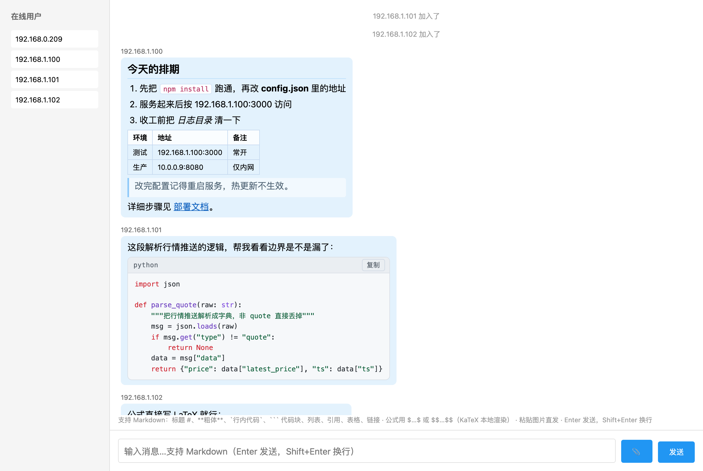
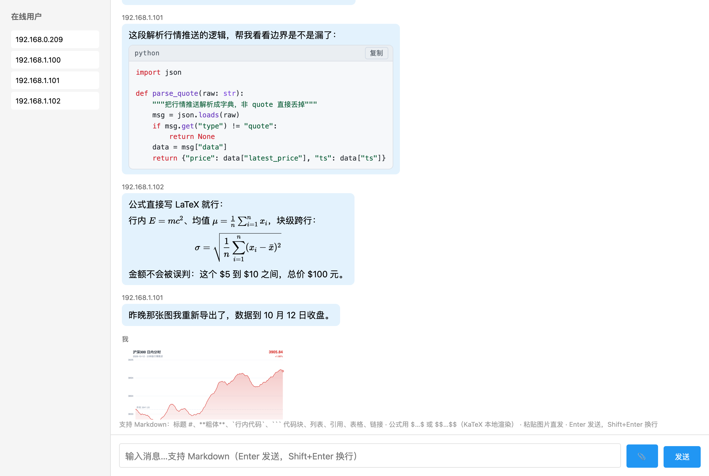
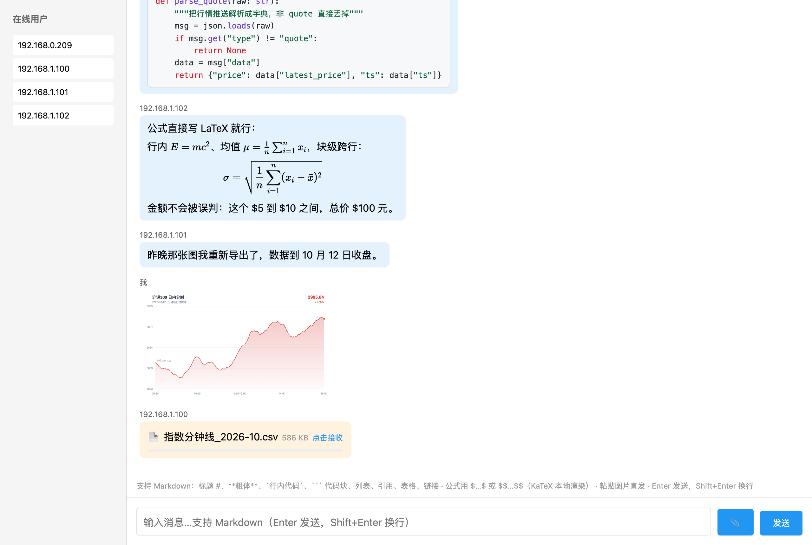
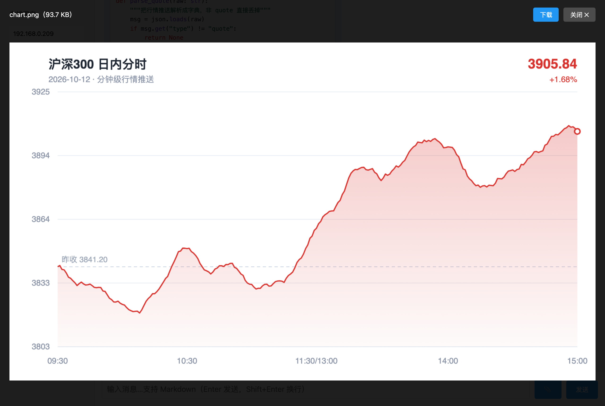

# 局域网通信工具

简单的局域网实时聊天、文件共享工具。



## 功能

- 📝 实时文本消息（支持多行，Enter 发送 / Shift+Enter 换行）
- 🅼 **Markdown 渲染**：消息按 Markdown 发送，对方（和自己）看到的是渲染后的效果，不用手点任何按钮
- ➗ **公式渲染**：`$…$` 行内、`$$…$$` 块级，KaTeX 本地渲染（不依赖 CDN）
- 💻 代码块带语法高亮：` ```python ` 围栏 + 一键复制；**直接把代码粘贴进来也会自动识别**
- 🖼️ Cmd/Ctrl+V 粘贴截图/图片直接发送（点击可大图预览）
- 📎 任意文件传输（图片、文档、视频等，支持拖拽）
- ⚡ 文件 P2P 点对点直传（WebRTC DataChannel）：不经过服务器、不占服务器磁盘，速度取决于网卡
- 👥 在线用户列表
- 🔔 加入/离开通知

> 注意：P2P 传输需要**收发双方同时在线**——发送方分享后，接收方点击"接收"即建立直连；发送方离线或刷新页面会导致未接收的分享失效。

## 界面预览

**代码与公式**：围栏代码块带语法高亮和一键复制；公式用 `$…$` / `$$…$$`，
KaTeX 在本地渲染。截图里那个「这个 $5 到 $10 之间」没有被误判成公式。



**图片与文件**：粘贴的截图直接变成图片消息（点击看大图）；其他文件走点对点卡片，
对方点「接收」才开始传，不落服务器磁盘。



**大图预览**：点消息里的图片放大查看，可下载原图。



## 使用方法

1. 安装依赖：
```bash
npm install
```

2. 启动服务：
```bash
npm start
```

3. 在局域网内其他设备浏览器访问显示的地址（如 `http://192.168.1.100:3000`）

> 页面必须**经服务器**打开。前端逻辑是 ES 模块，直接双击 `index.html` 用 `file://` 打开，
> 浏览器会因为跨域限制拒绝加载模块——那样页面排版还在，但功能是死的。

## Markdown 支持

输入时直接写 Markdown 语法，发送后自动渲染：

| 语法 | 效果 |
|---|---|
| `# 标题` ~ `###### 标题` | 一到六级标题 |
| `**粗体**`、`*斜体*`、`~~删除线~~` | 行内样式（`_斜体_` 也支持，词内下划线如 `foo_bar` 不会被误判） |
| `` `行内代码` `` | 行内代码块 |
| ` ```python ` 代码 ` ``` ` | 带语法高亮的代码块 + 复制按钮 |
| `- 项` / `1. 项`，缩进两格 | 无序 / 有序列表，可嵌套 |
| `> 引用` | 引用块，可嵌套 |
| `\| a \| b \|` + `\|---\|---\|` | 表格（支持 `:---:` 对齐） |
| `[文字](https://…)`、`https://…` | 链接（自动识别裸链接） |
| `$E=mc^2$` | 行内公式（KaTeX 渲染） |
| `$$…$$`、`\[…\]` | 块级公式，可跨行，居中显示 |
| `` | 图片；加载失败会降级成链接 |
| `---` | 分割线 |
| `\*` | 转义，原样显示 `*` |

另外，**整段直接粘贴代码、没写围栏也会自动识别成代码块**（按内容猜语言，中文占比高的自然语言不会被误判）；识别错了点代码块右上角「文本」即可在本机按纯文本显示。

支持高亮的语言：js/ts、python、bash、json、html、sql、css、go、java、rust、c/cpp、yaml 等；未列出的语言按通用规则着色。Markdown 与高亮都是内置的轻量实现，**不依赖任何 CDN**，断网/纯局域网可用。

### 公式

用 [KaTeX](https://katex.org/) 渲染，不走 CDN——它作为 npm 依赖装在本地，由 `server.js` 的静态服务提供（`/node_modules/katex/dist/…`），所以纯局域网/断网环境一样能渲染。

- 行内：`$E=mc^2$`、`$\frac{a}{b}$`、`$a_i * b_j$`（公式里的 `_` `*` 不会被 Markdown 当成强调语法）
- 块级：`$$…$$` 或 `\[…\]`，可跨行，居中显示；公式过长时横向滚动
- 金额不会被误判：`这个 $5 到 $10 之间` 会原样显示；要写明确的公式用 `$x + y$`
- 想显示字面美元号：`\$x+y\$`
- 代码块 / 行内代码里的 `$` 不会触发公式
- 公式写错了不会崩，KaTeX 会把出错的部分标红显示

> 安全：公式渲染关掉了 KaTeX 的 `trust`（禁用 `\href`、`\includegraphics` 等可外链/注入的宏），并限制了宏展开上限，避免一条消息把浏览器卡死。

> 安全：消息内容全程只创建 DOM 节点、不拼接 HTML，所以消息里的 `<script>`、`onerror=` 之类只会原样显示文字；链接只放行 `http/https/mailto/ftp`，`javascript:`、`data:` 这类不会变成可点击链接。


## 技术栈

- Node.js + Express
- Socket.IO (WebSocket 实时通信)
- 原生 HTML/CSS/JS + **ES Modules**（无构建步骤，浏览器直接跑 `js/` 下的源码）
- KaTeX（公式渲染，本地依赖，不依赖 CDN）

## 开发 / 改渲染逻辑时

页面逻辑按功能拆在 `js/` 下（见文件说明），消息渲染相关的在
`markdown.js` / `highlight.js` / `code-block.js` / `math.js`。
改之前先跑测试，改完再跑一次：

```bash
npm test          # 回归测试：37 项断言，失败退出码非 0
npm run preview   # 生成 test/preview.html，用浏览器验收排版
```

预览页要**经服务器**打开（逻辑是 ES 模块，浏览器不允许用 `file://` 加载模块）：

```bash
npm start                                        # 另开一个终端
# 然后访问 http://localhost:3000/test/preview.html
```

测试原理、覆盖范围、以及几个容易踩的坑（递归正则、`$$` 被 `String.replace` 折叠、
`</script>` 截断等）都记在 [`test/README.md`](test/README.md)。

## 文件说明

- `server.js` - 后端服务器（HTTP 静态服务 + Socket.IO + WebRTC 信令转发）
- `index.html` - 页面骨架：DOM 结构 + 样式，**没有内联脚本**，逻辑全部外链到 `js/`
- `js/` - 前端逻辑，按功能分文件，入口是 `main.js`
- `test/` - 渲染回归测试与预览页
- `docs/screenshots/` - README 里用到的界面截图
- `package.json` - 依赖配置

### js/ 内部

| 文件 | 职责 |
|---|---|
| `main.js` | 入口：装配各模块，把服务器推来的事件分发给对应模块 |
| `socket.js` | 与服务器的连接（全项目唯一持有 socket 实例的地方） |
| `dom.js` | DOM 元素引用 + 通用小工具（转义、体积格式化、下载、随机 token） |
| `compose.js` | 输入区：发文本、发文件、粘贴截图、拖拽、输入框自动增高 |
| `users.js` | 左侧在线用户列表 |
| `messages.js` | 消息列表（文本消息 / 系统提示） |
| `markdown.js` | Markdown 解析 + 消息正文渲染入口 |
| `highlight.js` | 代码高亮 + 语言猜测 + 「这段是不是代码」判断 |
| `code-block.js` | 代码块的 DOM 与交互（复制 / 文本逃生口） |
| `math.js` | 公式渲染（KaTeX） |
| `clipboard.js` | 复制到剪贴板（非安全上下文下的兜底） |
| `image.js` | 图片消息（小图 base64 直发，大图转 P2P） |
| `p2p.js` | 文件点对点直传（WebRTC DataChannel）+ 信令、mDNS 候选改写 |
| `lightbox.js` | 图片大图预览 |
| `package.json` | 仅用于标记 `js/` 是 ES Module 目录，**不是**独立的 npm 包 |

模块依赖是单向的：`dom.js` / `highlight.js` / `math.js` 是底座，`main.js` 是装配层，
功能模块之间只通过 `socket.js` 和 `main.js` 的事件路由协作，没有循环依赖。

